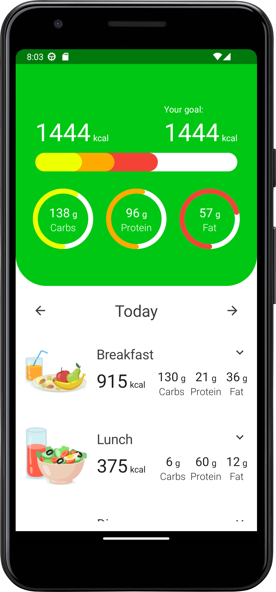
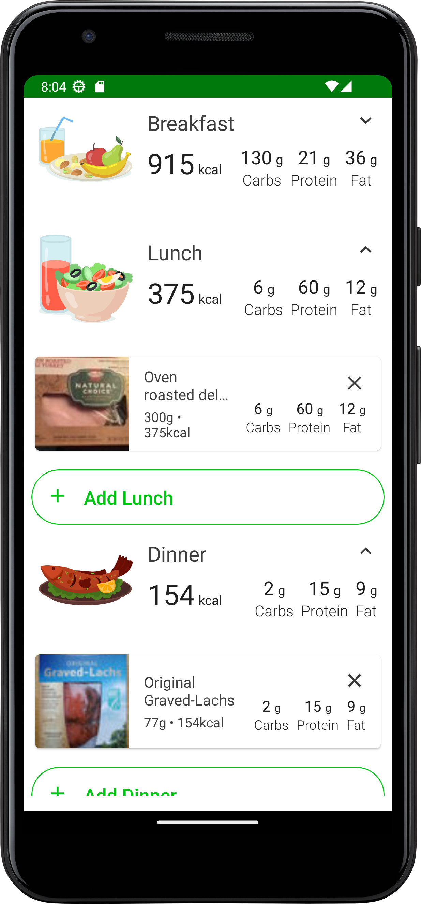
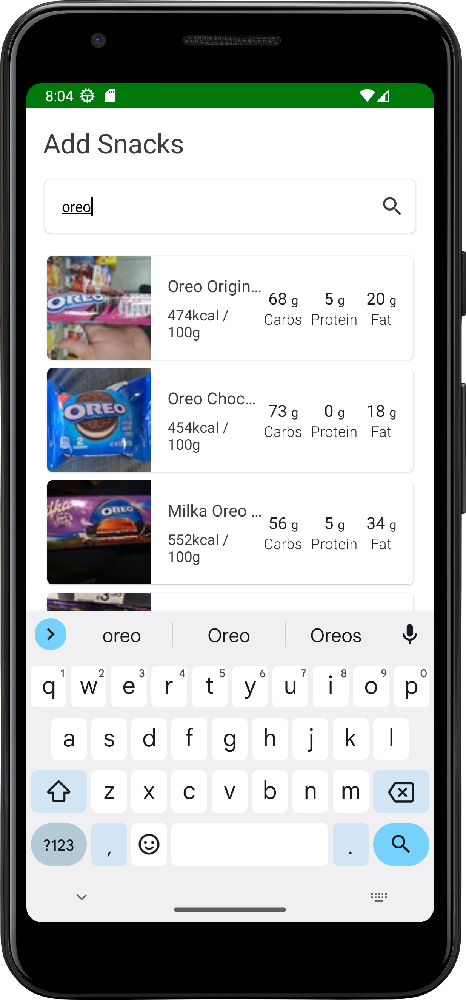
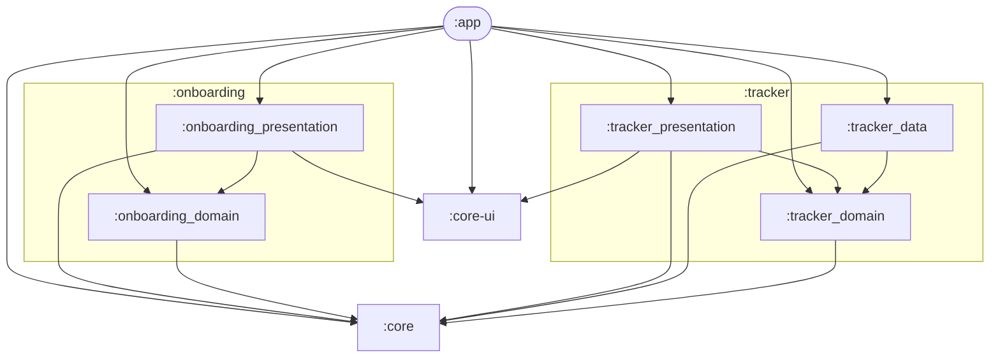
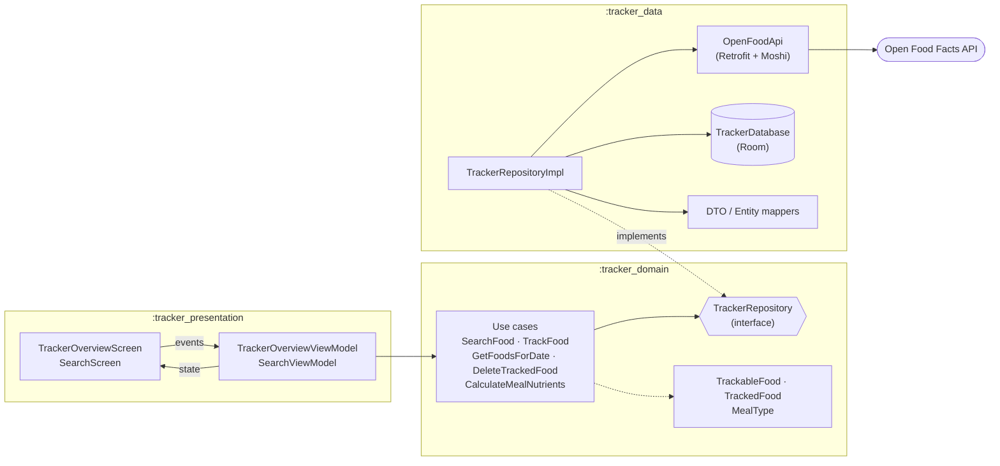
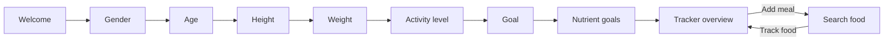

# CalorieTracker

A calorie and macro tracker for Android, built with Jetpack Compose. It uses a multi-module **clean architecture** setup.

You enter your body stats and goal once. The app then works out a daily calorie target and a carbs, protein and fat split. You log meals by searching the [Open Food Facts](https://world.openfoodfacts.org/) database.

<table align="center">
  <tr>
    <td align="center"></td>
    <td align="center"></td>
    <td align="center"></td>
  </tr>
  <tr>
    <td align="center"><b>Daily overview</b><br/>Calorie goal and macro progress</td>
    <td align="center"><b>Meal diary</b><br/>Expandable meals with tracked foods</td>
    <td align="center"><b>Food search</b><br/>Live results from Open Food Facts</td>
  </tr>
</table>

## Features

- **Onboarding flow**: You pick your gender, age, height (cm), weight (kg), activity level and goal (lose, keep or gain weight). You also set a custom macro split, and the app checks that the three percentages add up to 100%.
- **Personal calorie target**: The app calculates basal metabolic rate (BMR) with the Harris–Benedict equation and multiplies it by an activity factor (1.2 / 1.3 / 1.4). It then subtracts 500 kcal to lose weight, adds 500 kcal to gain weight, or makes no change to keep weight.
- **Macro goals**: The calorie target is turned into grams using 4 kcal/g for carbs and protein and 9 kcal/g for fat.
- **Food search**: Search results come live from the Open Food Facts API and include product photos and per-100 g nutrients. You enter a portion in grams and add it to a meal.
- **Meal diary**: Entries are grouped into Breakfast, Lunch, Dinner and Snacks. Each meal section expands to show its own calorie and macro totals.
- **Day navigation**: You can step backwards and forwards through days to review or log food.
- **Progress at a glance**: An animated calorie bar shows how much of the daily goal is used, split by macro. Rings show carbs, protein and fat against their goals.
- **Offline diary**: Tracked food is stored locally in Room. User profile and goals are kept in SharedPreferences.

## Architecture

The project is split by **feature** and then by **layer**. This keeps each feature's domain logic free of Android and framework code.

```
CalorieTracker
├── app                        # Entry point, navigation graph, Hilt setup
├── core                       # Shared models, preferences, UiText/UiEvent utilities
├── core-ui                    # Shared colors, dimensions (spacing)
├── onboarding
│   ├── onboarding_domain      # Input validation use cases
│   └── onboarding_presentation# Gender → Age → Height → Weight → Activity → Goal → Nutrients
└── tracker
    ├── tracker_data           # Retrofit API, Room DB, mappers, repository impl
    ├── tracker_domain         # Models, repository interface, use cases
    └── tracker_presentation   # Overview + search screens (Compose, ViewModels)
```

- **Presentation**: Compose screens, each with a ViewModel that exposes state and handles events (MVVM, unidirectional data flow).
- **Domain**: Pure Kotlin use cases (`SearchFood`, `TrackFood`, `GetFoodsForDate`, `DeleteTrackedFood`, `CalculateMealNutrients`) behind a `TrackerRepository` interface.
- **Data**: `TrackerRepositoryImpl` combines the remote API and the local Room database, with mappers between DTOs, entities and domain models.
- **Build logic**: Dependency versions are centralised in `buildSrc`. Shared Gradle config lives in `base-module.gradle` and `compose-module.gradle`.

### Module dependency graph

Arrows point from a module to the modules it depends on. Presentation modules only depend on their feature's **domain** module, never on **data**. Only `app` sees every module so it can wire them together with Hilt.



### Layers inside the tracker feature

The domain layer owns the `TrackerRepository` interface, and the data layer implements it (dependency inversion). At runtime, Hilt in `app` binds the implementation to the interface.



### Navigation flow



Onboarding runs only on first launch. After that, the app opens straight on the tracker overview.

##
